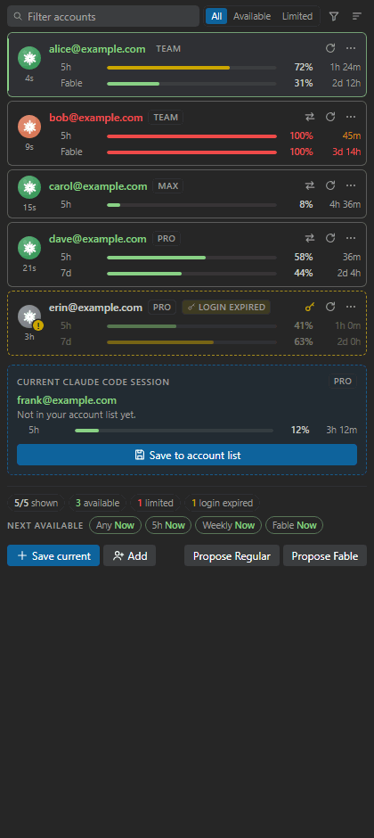
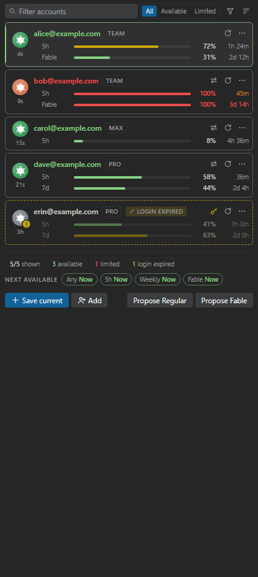
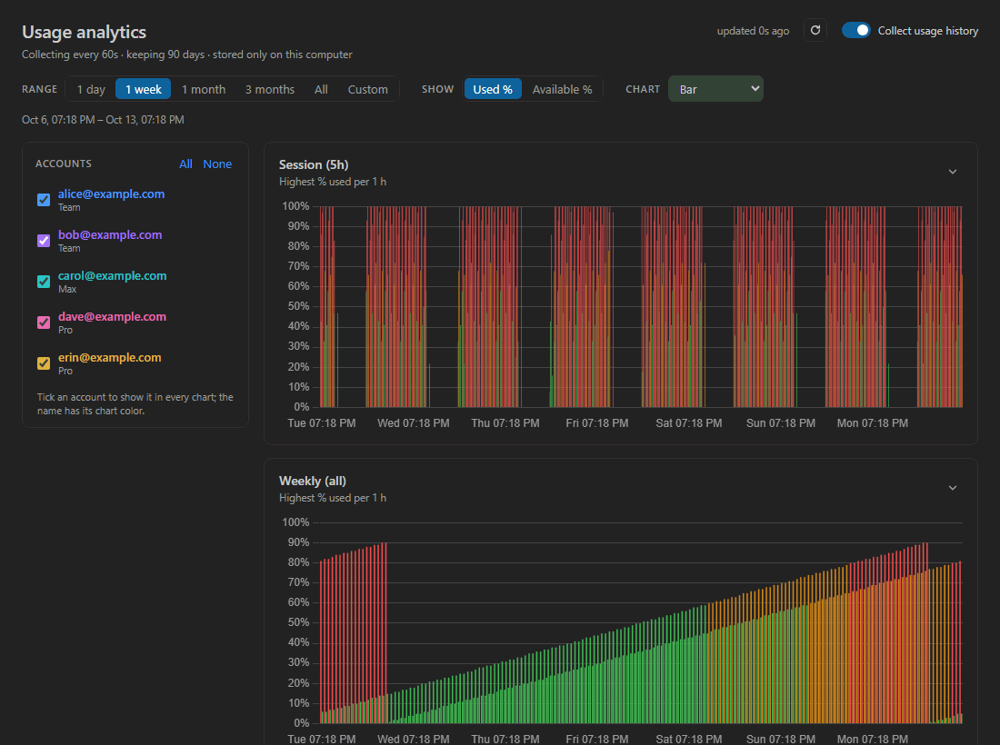
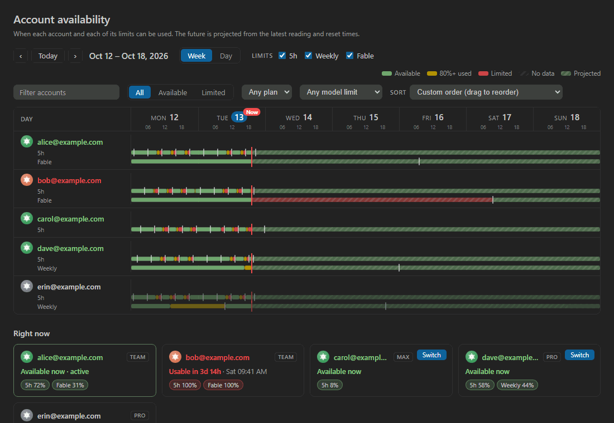

# Account Manager for Claude

Use several Claude subscriptions in **Claude Code** and switch between them with one click.
See every account's usage limits at a glance, and let the extension tell you which account to use
next.

- **Install:** [VS Code Marketplace](https://marketplace.visualstudio.com/items?itemName=tursoft.account-manager-for-claude),
  or run `ext install tursoft.account-manager-for-claude` in Quick Open (`Ctrl+P`).
- **Source:** [github.com/tursoft/account-manager-for-claude](https://github.com/tursoft/account-manager-for-claude)

> Built on [KrzysztofZander/claude-account-switcher](https://github.com/KrzysztofZander/claude-account-switcher)
> by Krzysztof Zander, which provided the original account-switching core. This version adds a
> redesigned panel and UI/UX, usage analytics with capacity-utilization tracking, an availability
> calendar, account proposals, and much more.

## Features

**Accounts panel**

- **Save and add accounts.** A detected login that isn't saved yet appears in its own box with a
  **Save** button. **Add account** logs in to another account without touching the current one.
- **Switch in one click** from an account card, the status bar, or the command palette.
- **Live usage limits** for the 5-hour, weekly, and model-specific (e.g. Fable) windows, with the
  time until each resets. The data is the same as Claude Code's `/usage`.
- **Colors show the state.** The icon is green while an account has limit left, orange once a
  limit is used up, and gray when usage is unknown. The name turns red when the 5h or a weekly
  limit is used up. A used-up limit's reset time turns yellow under 10 minutes, orange under an
  hour, and red beyond a day.
- **Filter and sort** by text, availability, plan (Pro, Max, Team, ...), or model limit. Sort by
  availability, usage left, next reset, plan, name, or your own drag-and-drop order.
- **Adapts to your setup.** Filters, sorting, and statistics appear once you have two accounts.
  With one account, the panel shows just its card.
- **Status bar** with the active account and its usage, colored green, orange, or red.
- **Notifications** when a used-up limit becomes available again, with a **Switch** button.

**Account proposals**

- **Propose** and **Propose for Fable** list the three best other accounts for that limit, each
  with its limit bar, a one-line reason, and a **Switch** button.
- Accounts whose capacity would be lost soonest come first: the most available percent per hour
  until the limit resets. Accounts with a used-up limit or an expired login are skipped.
- When the active account's limit runs out, the next accounts are proposed automatically:

  

**Logins that stay valid**

- The extension refreshes tokens the same way Claude Code does, so neither side is left with a
  spent token and you don't have to log in again every day. See [Token handling](#token-handling).
- **Browser login** works without the Claude Code CLI. **Reauthorize** fixes a broken saved login
  without touching the active account.
- **Independent windows** open the same project in separate VS Code windows, each with its own
  account. See [Parallel windows](#parallel-windows).
- **Backup and restore** the account list in a password-protected ZIP. See
  [Backup and restore](#backup-and-restore).

## Usage analytics

Turn on **Collect usage history** (on the analytics page or in settings) to record every account's
limits once a minute. Readings stay on this computer and are kept for 90 days by default.

Open **Show usage analytics** (the chart icon in the panel's title bar) to see:

- **Charts per limit** (5h, weekly, Fable, ...) over 1 day, 1 week, 1 month, 3 months, everything,
  or a custom range. Show **Used %** or **Available %** as bar, stacked bar, line, or area charts.
  Bars are green below 60%, orange from 60%, and red from 80% used.
- **A shared legend** with a checkbox per account to show or hide it in every chart.
- **Capacity utilization:** how much of the capacity each limit offered was actually used. A 5h
  limit refills every 5 hours and a weekly limit every 7 days, so capacity not used before a reset
  is lost. You see the overall figure, a figure per limit and per account, and charts over time.
- **By calendar period:** the same utilization grouped by weekday, hour of day, week, or month,
  with the best and lowest period named.

Charts fold into a small sparkline, show guide lines on hover, and refresh every 2 minutes.
**Delete collected usage history** removes all readings.

## Availability calendar

Open **Show account availability calendar** (the calendar icon in the title bar) to see when each
account can be used, for a week or hour by hour for a single day.

- Pick which limits to show (5h, weekly, Fable, ...). Each gets its own lane per account.
- Green is available, amber is 80%+ used, red is limited, and gray is no data. Markers show reset
  times and a red line shows now.
- The past comes from collected usage history. The future is projected from the latest reading
  and drawn striped.
- Use the same filters and sorting as the panel, and drag rows to reorder in custom order.
- A **Right now** card per account shows its current state, how usable it was in the period, how
  often it ran out, and a **Switch** button.

## Getting started

1. Log in to Claude Code with your first account.
2. Open the **MultiAccount** panel from the activity bar and click **Save this account**.
3. Click **Add account** and log in with another account. The current account is not changed.
4. Switch with the blue **Switch** button on a card, the status bar, or `Claude: Switch account`.
5. **Reload the window after switching** so Claude Code picks up the new account. The extension
   offers to do it, or turn on `autoReloadAfterSwitch`.

> **Never use `/logout` to change accounts.** It revokes that login on Anthropic's side, and a
> saved copy dies with it. Use **Switch**, **Add account**, or `/login` instead.

## Commands

| Command | What it does |
| --- | --- |
| `Claude: Switch account` | Pick an account, with its usage limits |
| `Claude: Save current account as profile` | Save the account Claude Code is logged in with |
| `Claude: Add another account (isolated login)` | Log in to another account without touching the current one |
| `Claude: Refresh accounts, current login and limits` | Re-read everything now |
| `Claude: Refresh usage limits` | Re-read usage limits now |
| `Claude: Show accounts panel` | Open the accounts panel |
| `Claude: Show usage analytics` | Open the analytics page |
| `Claude: Show account availability calendar` | Open the availability calendar |
| `Claude: Open independent account window` | Open this project in a new window for one account |
| `Claude: Log in from terminal (replaces the current account)` | Run `claude auth login` (or browser login without the CLI) |
| `Claude: Authorize in browser (without CLI)` | Log in through the browser |
| `Claude: Reauthorize account profile` | Log a saved account in again, without touching the active one |
| `Claude: Complete profile reauthorization` | Finish a reauthorization |
| `Claude: Undo last switch` | Restore the previous account |
| `Claude: Rename account profile` / `Remove account profile` | Manage saved accounts |
| `Claude: Back up account list (password-protected ZIP)` | Save all accounts to an encrypted ZIP |
| `Claude: Restore account list from backup` | Merge a backup into the list |
| `Claude: Delete collected usage history` | Remove all usage readings |
| `Claude: About Account Manager for Claude` | Version, author, and project information |

## Settings

All settings start with `accountManagerForClaude.`.

| Setting | Default | Description |
| --- | --- | --- |
| `autoRefresh` | `true` | Check all accounts' usage limits regularly |
| `pollIntervalSeconds` | `240` | Seconds between checks (minimum 60; short intervals with many accounts can hit rate limits) |
| `notifyOnLimitReset` | `true` | Notify when a used-up limit is available again |
| `autoReloadAfterSwitch` | `false` | Reload the window automatically after switching |
| `warnThresholdPercent` | `80` | Usage bars and the status bar turn red from this percent, and orange from 75% of it |
| `usageHistory.enabled` | `false` | Collect usage history for analytics and the calendar |
| `usageHistory.intervalSeconds` | `60` | Seconds between usage readings (minimum 60) |
| `usageHistory.retentionDays` | `90` | Days of usage history to keep |
| `credentialsPath` | `""` | Custom path to `.credentials.json` (empty means `~/.claude/.credentials.json`) |
| `claudeCommand` | `claude` | The Claude Code CLI command; use the full path if VS Code can't find it |

## How it works

- **Switching** replaces `~/.claude/.credentials.json` and the cached account in `~/.claude.json`.
  A `.bak` copy lets you undo. Saved accounts are kept in VS Code's encrypted SecretStorage.
- **Usage** comes from Anthropic's unofficial usage endpoint, the same source as `/usage`. It is
  rate-limited, so checks run every 240 seconds by default, plus manual refresh.

### Token handling

Claude Code's refresh tokens work only once: each refresh replaces the token and invalidates the
old one. If two programs share a login and one refreshes, the other is logged out. To prevent
this, the extension:

- takes Claude Code's own refresh lock before refreshing, so Claude Code waits and picks up the
  new token;
- writes every new token back to all local copies and to the saved account;
- always uses the newest token it can find, and refreshes only when the current one is expiring;
- watches `.credentials.json` and picks up Claude Code's own refreshes immediately;
- saves the account you switch away from first, so it keeps its latest token;
- never retries a token the server rejected.

Each login is independent, so logging in on another computer doesn't affect this one. Saved
accounts are stored per machine; add them on each computer, or use a backup.

### Parallel windows

By default all VS Code windows share one Claude Code login. **Open independent account window**
(or the **Window** item on a card) opens the project in a new window that uses its own config
directory through `CLAUDE_CONFIG_DIR`. You can run one window per account. The extension won't
open a second window for the same account, because both would spend the same refresh token.

### Backup and restore

**Back up** and **Restore** are in the panel's **⋯** menu. The backup is a ZIP encrypted with
AES-256 and your password; 7-Zip can open it too. It also stores your panel choices and settings
(except `credentialsPath`).

- **It contains login tokens.** Anyone with the file and the password can use those accounts.
- Restoring merges into the current list. It adds missing accounts and uses the backup's tokens
  only if they are newer.
- Tokens in an old backup may already be spent; use **Reauthorize** on those accounts.
- Don't use the same restored account on two machines at once.

## Requirements and troubleshooting

- VS Code 1.85 or newer, on Windows or Linux. The macOS Keychain isn't supported yet.
- The Claude Code CLI is optional for switching, usage checks, and browser login. Logging in from
  the terminal needs it.

If the extension says `claude` is not recognized:

1. Run `where claude` in PowerShell or CMD.
2. If it's found, restart VS Code so it picks up the updated PATH.
3. If it isn't found, install the CLI. On Windows: `irm https://claude.ai/install.ps1 | iex`
4. If VS Code still can't find it, set `claudeCommand` to the full path, e.g.
   `C:\Users\you\AppData\Roaming\npm\claude.cmd`.

## Privacy and security

- **No telemetry.** The extension collects no data and sends nothing to its author, publisher,
  or any third-party server.
- **Sidebar ad.** The panel shows a small ad for [BestJobFinder](https://bestjobfinder.net). It
  loads nothing from the network; clicking it opens the site in your browser.
- **Network requests go only to Anthropic**, for token refresh, usage limits, and identifying an
  account (`/api/oauth/profile`, the same call Claude Code makes after login).
- Saved accounts are kept in VS Code's encrypted SecretStorage. Credentials are written only to
  local Claude Code config folders and are never logged.
- Anyone with access to your user profile can read Claude Code's credential files, so protect your
  computer account.
- Use it only for **your own** accounts. The usage endpoint and the token refresh are unofficial
  and may change on Anthropic's side.

## Development

Requires [Node.js](https://nodejs.org/) 18+ and VS Code 1.85+. Run `npm install` first.

| Script | What it does |
| --- | --- |
| `npm run compile` / `watch` | Development build, once or on every change |
| `npm run package` | Minified production build |
| `npm run typecheck` | Type-check with `tsc` (the build itself doesn't) |
| `npm run test:smoke` | Run the tests |
| `npm run build:vsix` | Build the installable `.vsix` |
| `npm run install:vsix` | Install the built `.vsix` into VS Code |
| `npm run deploy` | Build and install in one step |
| `npm run publish` / `release` | Check, then publish to the Marketplace (`release` also bumps the patch version) |

- **Run and debug:** open the folder and press **F5** to start an Extension Development Host. Run
  **Developer: Reload Window** there after changes, and **Developer: Open Webview Developer Tools**
  to debug the pages. The development host uses your real Claude credentials, so be careful with
  Switch, Remove, and logins.
- **Webview code:** `webview/*.js` is bundled into `dist/webview/`, so rebuild after editing it.
  Shared logic lives in `src/`.
- **Install the `.vsix` from VS Code**, not by double-clicking it in Explorer: that may open
  Visual Studio's installer, which can't install VS Code extensions.

### Publishing

1. Create a publisher at <https://marketplace.visualstudio.com/manage>. Its ID must match
   `publisher` in `package.json`.
2. In Azure DevOps (<https://dev.azure.com>), create a Personal Access Token with
   **Organization: All accessible organizations** and the scope **Marketplace → Manage**.
3. Run `npx vsce login <publisher-id>`, or set the token in the `VSCE_PAT` environment variable.
   Never commit it.
4. Update `CHANGELOG.md`, then run `npm run publish` or `npm run release`. Both stop if the type
   check or tests fail.

To publish to [Open VSX](https://open-vsx.org/) as well, run `npx ovsx publish -p <token>`.

## License

MIT
